<!--
  Blocship org profile. Static art: python scripts/build_org.py -> profile/assets.
  Open-source cards are regenerated by .github/workflows/profile.yml onto the `generated` branch.
  Copy and numbers mirror https://blocship.io
-->

<a href="https://blocship.io/"><picture>
  <source media="(prefers-color-scheme: dark)" srcset="assets/hero-dark.svg">
  
</picture></a>

 

<picture>
  <source media="(prefers-color-scheme: dark)" srcset="assets/headers/work-dark.svg">
  
</picture>

Most portfolios only show the highlight reel. These four are the real version, including what broke once real users showed up, and how we fixed it.

<a href="https://www.thecourier.app/"><picture><source media="(prefers-color-scheme: dark)" srcset="assets/cases/1-dark.svg"></picture></a> <a href="https://ydigest.app/"><picture><source media="(prefers-color-scheme: dark)" srcset="assets/cases/2-dark.svg"></picture></a>
<a href="https://www.caloriecounter.com.au/"><picture><source media="(prefers-color-scheme: dark)" srcset="assets/cases/3-dark.svg"></picture></a> <a href="https://www.withlyla.com/"><picture><source media="(prefers-color-scheme: dark)" srcset="assets/cases/4-dark.svg"></picture></a>

 

<picture>
  <source media="(prefers-color-scheme: dark)" srcset="assets/headers/problems-dark.svg">
  
</picture>

Payments edge cases, device sensors, multi-tenant platforms, store review. The complexity that quietly sinks a launch, and we've shipped through all of it.

<picture>
  <source media="(prefers-color-scheme: dark)" srcset="assets/problems-dark.svg">
  
</picture>

 

<picture>
  <source media="(prefers-color-scheme: dark)" srcset="assets/headers/approach-dark.svg">
  
</picture>

<picture>
  <source media="(prefers-color-scheme: dark)" srcset="assets/approach-dark.svg">
  
</picture>

**What you're actually paying for.** We optimise for your outcome, not our billable hours. A client once asked for a mobile app, roughly sixty hours of work from scratch. We got the same result running on the stack they already had in about two.

**When we're not the right fit.** If you need a fifty-person body shop, pure staff augmentation, or someone who'll just nod along, that isn't us. We're a small senior team, and we'd rather say so on the first call.

 

<picture>
  <source media="(prefers-color-scheme: dark)" srcset="assets/headers/oss-dark.svg">
  
</picture>

We contribute back to the tools we rely on. Cards refresh twice a day.

<picture>
  <source media="(prefers-color-scheme: dark)" srcset="https://raw.githubusercontent.com/Blocship/.github/generated/oss-dark.svg">
  
</picture>

 

<picture>
  <source media="(prefers-color-scheme: dark)" srcset="assets/headers/team-dark.svg">
  
</picture>

You always deal with Shahzad for strategy, architecture and the hard calls. But you're never depending on a single pair of hands: a small senior team builds alongside him, so work moves quickly and nothing stalls when one person takes a day off.

<table align="center"><tr><td align="center" width="25%"> <b>Shahzad Umar Baig</b> Founder & principal engineer · sets the architecture on every build</td><td align="center" width="25%"> <b>Hashir Shoaib</b> Flutter · Dart · iOS</td><td align="center" width="25%"> <b>Abdullah Ahmed Soomro</b> Mobile application developer · Flutter & Dart</td><td align="center" width="25%"> <b>Hafiz Muhammad Anwar</b> Mobile application developer · Flutter</td></tr></table>

 

<picture>
  <source media="(prefers-color-scheme: dark)" srcset="assets/headers/contact-dark.svg">
  
</picture>

Send your PRD, your half-built app, or just the rough idea. You'll hear back personally within 24 hours with a real read on how we'd approach it. No canned pitch, no sales team in between.

1. You send the brief, as rough or as detailed as you've got.
2. Shahzad replies within 24 hours with first thoughts.
3. We jump on a call and screen-share the real thing.
4. You get a clear scope, timeline and price, or a straight no.

<a href="https://cal.com/shahzadumarbaig/15min"><picture><source media="(prefers-color-scheme: dark)" srcset="assets/buttons/call-dark.svg"></picture></a>
<a href="https://www.linkedin.com/company/blocship/"><picture><source media="(prefers-color-scheme: dark)" srcset="assets/buttons/linkedin-dark.svg"></picture></a>
<a href="https://blocship.io/"><picture><source media="(prefers-color-scheme: dark)" srcset="assets/buttons/website-dark.svg"></picture></a>
<a href="https://github.com/Blocship"><picture><source media="(prefers-color-scheme: dark)" srcset="assets/buttons/github-dark.svg"></picture></a>

  

<picture>
  <source media="(prefers-color-scheme: dark)" srcset="assets/footer-dark.svg">
  
</picture>

